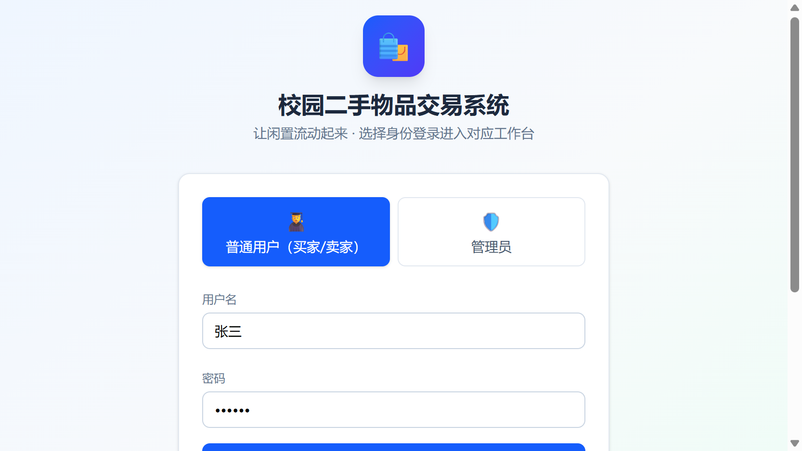
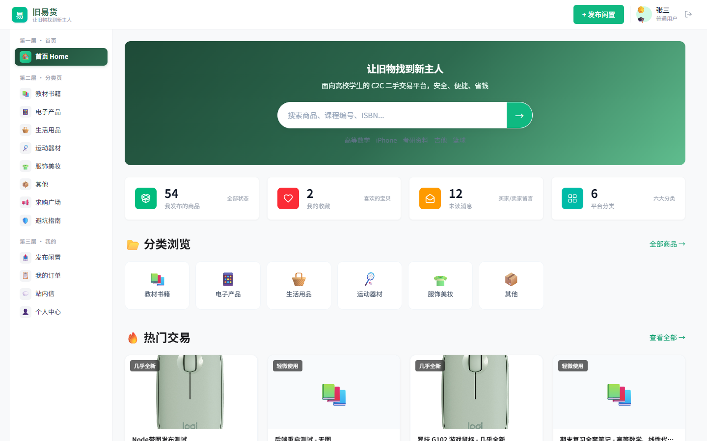
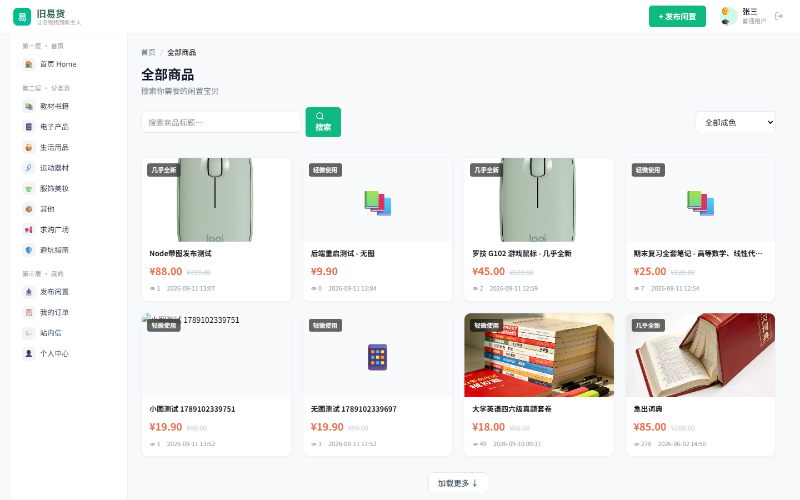
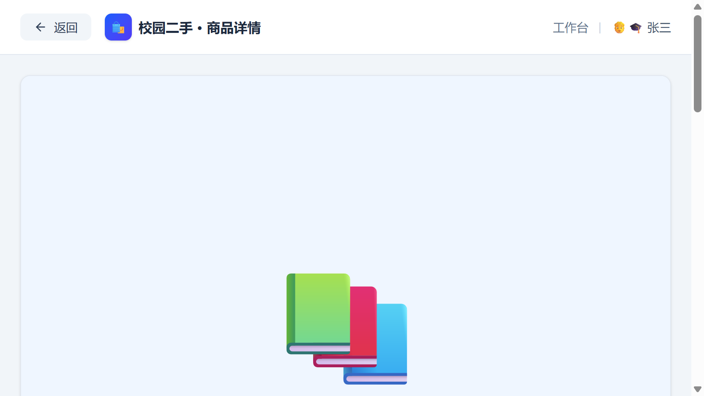
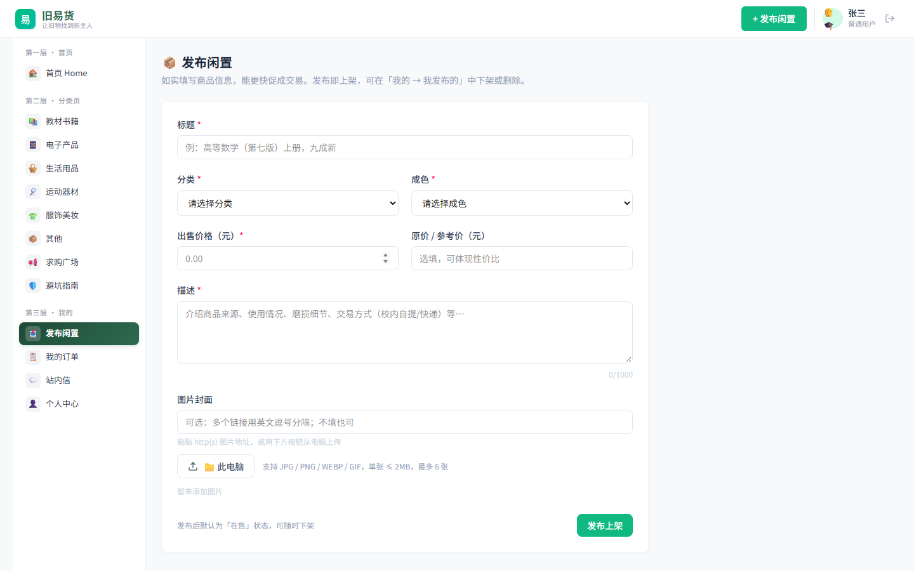
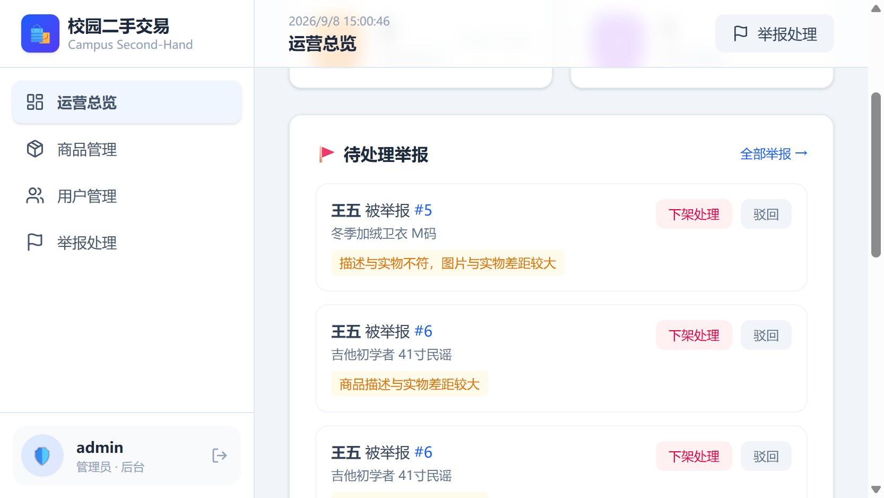
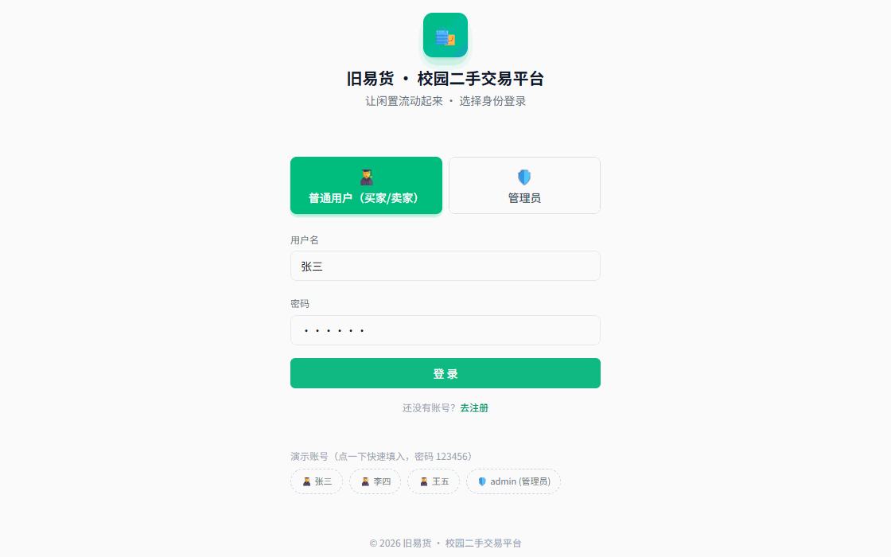

# 旧易货 · 校园二手交易平台

面向高校学生的 C2C 二手物品交易系统，覆盖「买家浏览 / 卖家发布 / 沟通下单 / 订单流转 / 平台治理」完整闭环。  
项目为课程设计/个人作品，前端 + 后端 + 数据库 + 文档均已开源在本仓库。

> 技术栈：`Vue 3.5` `Vite 6` `Tailwind CSS 4` `Pinia` `Vue Router` `Axios` ｜ `Spring Boot 3.4.5` `Java 17` `Spring Data JPA` `MySQL` `springdoc-openapi`

[](https://github.com/Enzelee-Lang/campus-secondhand-platform/actions/workflows/ci.yml)
[](#技术栈)
[](#技术栈)

## 页面预览

| 登录页 | 用户工作台 | 商品广场 |
|---|---|---|
|  |  |  |

| 商品详情 | 发布闲置 | 管理端仪表盘 |
|---|---|---|
|  |  |  |

### 流程演示



更多截图见：[`frontend/docs/screenshots`](frontend/docs/screenshots)

## 功能清单

### 用户端

- 注册 / 登录：用户与管理员双身份入口，登录后按角色进入不同工作台
- 首页工作台：搜索、热门标签、个人数据概览、分类入口、热门交易
- 商品广场：关键词搜索、分类筛选、成色筛选、游标分页加载更多
- 商品详情：浏览量、折扣展示、收藏、举报、联系卖家、立即购买、评价与卖家回复
- 发布闲置：标题 / 分类 / 成色 / 价格 / 描述 / 图片上传或图片链接
- 个人中心：资料编辑、发布管理、改价、上下架、删除、我的收藏
- 站内信 / 聊天：商品沟通、未读数、已读处理、订单状态卡片、订单操作入口
- 我的订单：买家支付 / 确认收货 / 重新下单，卖家确认订单 / 发货 / 取消订单
- 求购广场：发布求购、搜索求购、关闭 / 删除自己的求购
- 避坑指南：交易安全须知、常见骗局识别、售后处理入口

### 管理端

- 运营总览：用户、商品、订单、举报等平台数据统计与图表展示
- 商品管理：查看、上架、下架、删除商品
- 用户管理：启用 / 禁用用户，维护平台交易秩序
- 举报处理：对举报商品进行下架处理或驳回
- 订单查看：管理平台内订单状态与异常订单

## 项目亮点

- **完整交易闭环**：从商品发布、浏览、沟通，到下单、支付确认、发货、收货、评价，覆盖校园二手交易主流程。
- **角色化界面**：同一套系统区分普通用户与管理员，管理端独立菜单与数据看板。
- **真实后端对接**：前端通过 Axios 调用 Spring Boot REST API，非静态 Mock 页面。
- **游标分页**：商品列表使用游标分页，避免传统页码分页在数据更新时的重复/遗漏问题。
- **交易安全设计**：举报、禁用、下架、信用评分、避坑指南等机制，贴近校园交易场景。
- **可测试后端**：后端配置 JUnit + Mockito + JaCoCo，测试使用 H2 内存库隔离 MySQL。

## 技术栈

| 层 | 技术 |
|---|---|
| 前端 | Vue 3.5、Vite 6、Tailwind CSS 4、Pinia、Vue Router、Axios、ECharts、lucide-vue-next |
| 后端 | Spring Boot 3.4.5、Java 17、Spring Web、Spring Data JPA、Actuator、springdoc-openapi |
| 数据库 | MySQL（含初始化脚本）、H2（测试） |
| 工程化 | Maven Wrapper、Vite、JaCoCo、Swagger UI |

## 目录结构

```text
campus-secondhand-platform/
├── backend/                 # Spring Boot 后端接口服务
│   ├── src/main/java/com/campus/
│   ├── src/main/resources/  # application.properties、静态说明页
│   ├── src/test/            # Controller / Util 测试，H2 测试库
│   └── docs/                # 系统说明、测试报告、PPT 生成脚本
├── frontend/                # Vue3 + Vite 前端
│   ├── src/                 # api / store / router / layouts / views / components
│   ├── public/item-img/     # 商品演示图
│   └── docs/screenshots/    # README 页面截图
├── database/
│   └── campus_second_hand.sql
└── docs/                    # 使用说明、系统实现说明、功能界面说明
```

## 本地运行

环境要求：JDK 17、Node.js 18+、MySQL 8+。

```bash
# 1. 初始化数据库
# 创建数据库 campus_second_hand，然后导入：
# database/campus_second_hand.sql

# 2. 配置数据库环境变量（不要提交真实密码）
# Windows PowerShell
$env:MYSQL_USERNAME="root"
$env:MYSQL_PASSWORD="your_local_password"
# macOS / Linux
export MYSQL_USERNAME=root
export MYSQL_PASSWORD=your_local_password
# 如不是默认本地地址，再设置 MYSQL_URL

# 3. 启动后端（端口 8080）
cd backend
# Windows
mvnw.cmd spring-boot:run
# macOS / Linux
./mvnw spring-boot:run

# 4. 启动前端（端口 5173）
cd frontend
npm install
npm run dev
```

打开前端：<http://localhost:5173>  
接口文档：<http://localhost:8080/swagger-ui.html>

> 数据库连接配置在 `backend/src/main/resources/application.properties`，当前已改为读取 `MYSQL_URL` / `MYSQL_USERNAME` / `MYSQL_PASSWORD` 环境变量。

## 演示账号

| 角色 | 账号 | 说明 |
|---|---|---|
| 普通用户 | 张三 / 李四 / 王五 | 买家、卖家身份一体 |
| 管理员 | admin | 可进入管理端 |

演示密码由初始化脚本写入，仅用于本地课程演示，不要用于生产环境。

## 测试与构建

```bash
# 后端测试（H2 内存库，不依赖本地 MySQL 数据）
cd backend
mvnw.cmd test

# 前端生产构建
cd frontend
npm run build
```

## 相关文档

- 系统实现说明：[`docs/系统实现说明文档.md`](docs/系统实现说明文档.md)
- Trae 使用/启动说明：[`docs/校园二手交易系统-Trae使用说明.md`](docs/校园二手交易系统-Trae使用说明.md)
- 功能界面说明：[`frontend/docs/项目功能界面说明.md`](frontend/docs/项目功能界面说明.md)
- 后端课程文档与实验报告：[`backend/docs`](backend/docs)

## 简历项目描述示例

校园二手交易平台（Vue3 + Spring Boot + MySQL）｜个人项目  
实现商品发布/搜索/收藏/聊天/订单/求购/举报与后台管理；支持 JWT 登录、信用分交易限制、游标分页商品列表、订单状态流转与运营数据统计。

## 说明

本项目为课程设计/个人学习作品，重点展示业务闭环、前后端联调与工程结构。若要继续作品化，可优先升级：对象存储图片、WebSocket 实时聊天、部署上线、敏感配置环境变量化、接口限流与更完整的权限模型。
