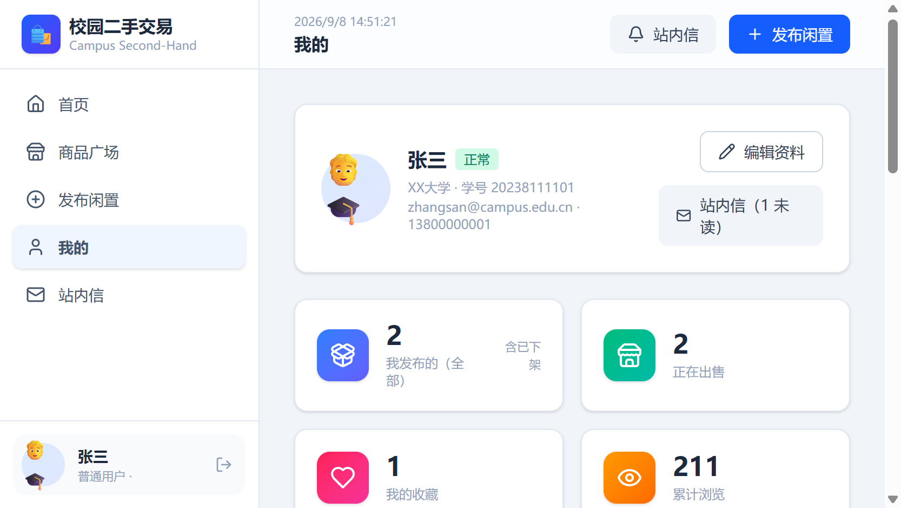
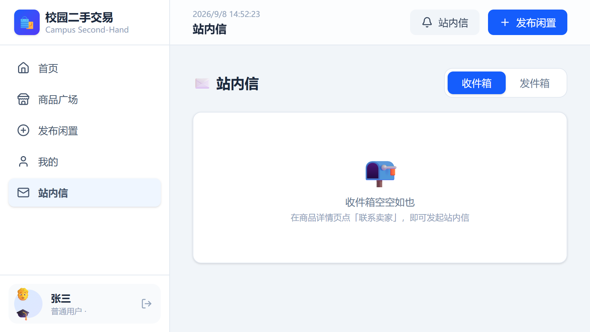
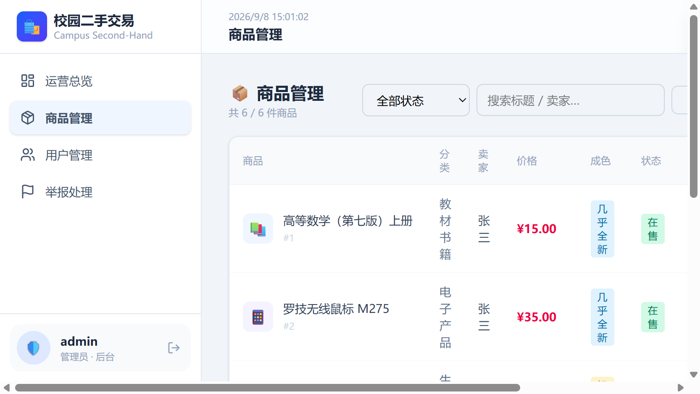
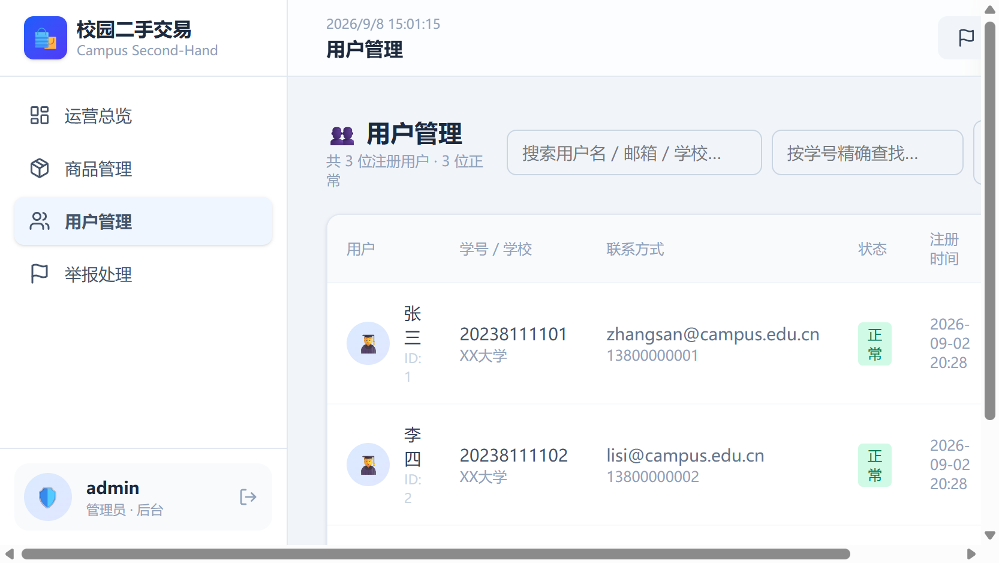

# 校园二手物品交易系统 · 功能界面说明

> 技术栈：Vue 3 + Vue Router + Pinia + Tailwind CSS（前端）｜ Spring Boot + JPA + MySQL（后端）
> 截图日期：2026-09-08

---

## 一、用户端（买家 / 卖家）

### 1. 登录页


系统统一入口。支持「普通用户」与「管理员」角色切换，提供演示账号一键填入（密码统一为 123456），底部可切换至注册表单。

---

### 2. 用户工作台首页


登录后落地页。顶部展示欢迎语与未读消息提醒，包含个人统计卡片、快捷功能入口（发布、广场、消息、我的）以及最新在售商品推荐列表。

---

### 3. 商品广场


全部在售商品浏览页。支持分类筛选、成色筛选、关键词搜索，采用游标分页加载（`/api/items/page`），点击商品卡片可跳转详情。

---

### 4. 商品详情


商品完整信息展示。左侧含封面、描述、成色 / 浏览量 / 编号等元数据、买家评价区（含评分与卖家回复）；右侧为购买面板（联系卖家、收藏、举报）与卖家信用卡片、TA 的其他在售。

---

### 5. 发布商品


卖家发布新商品表单。包含标题、分类（下拉来自 `/api/categories`）、成色、售价 / 原价、描述、图片链接等字段，提交后调用 `POST /api/items`。

---

### 6. 我的页面



个人中心。展示个人信息（可编辑邮箱 / 手机 / 学校）、我发布的商品（支持编辑 / 删除）、我的收藏（可取消收藏），以及未读消息计数提醒。

---

### 7. 站内信



站内消息系统。支持收件箱 / 发件箱切换查看，展示与各卖家买家就某商品的沟通记录，可标记已读、发送新消息（`/api/messages`）。

---

## 二、管理端（管理员）

### 8. 运营总览（仪表盘）


管理员后台首页。统计卡片展示注册用户数、在售商品数、待处理举报数等运营指标；下方滚动展示待处理举报列表与最新发布商品，便于快速掌握平台状态。

---

### 9. 商品管理



全部商品后台管理表格。支持按状态筛选、关键词搜索；可执行上架 / 下架 / 删除操作；顶部「导出 CSV」按钮调用 `/api/items/export` 下载商品数据，「分类管理」按钮弹窗内新增 / 删除商品分类。

---

### 10. 用户管理



注册用户管理表格。支持按用户名 / 邮箱 / 学校模糊搜索，以及按学号精确查找（调用 `/api/users/student/{studentId}`）；可对用户执行启用 / 禁用操作（`/api/admin/users/{id}/status`）。

---

## 接口接入说明

前端 `src/api/index.js` 共封装 41 个 API 函数，覆盖后端全部 33 个业务接口（另 2 个基础设施接口 `/`、`/api/health` 无需前端接入）。上述 10 个页面均已接入真实后端接口，无纯静态 / mock 数据页面。

---

## 三、后端接口说明

后端基于 Spring Boot 3 + Spring Data JPA + MySQL，服务端口 `8080`，无全局 context-path（接口路径即 Controller 中定义的相对路径）。所有业务接口均挂载在 `/api` 前缀下，由 Vite 开发服务器代理转发（`/api → http://127.0.0.1:8080`）。

### 统一响应结构

所有 JSON 接口均返回统一包装结构 `Result<T>`：

```json
{
  "code": 200,
  "message": "success",
  "data": { /* 实际业务数据，类型由接口决定 */ }
}
```

- `code = 200` 表示业务成功，前端拦截器直接返回 `data` 给调用方
- `code = 500` 或其他表示业务失败，`message` 为错误提示，前端拦截器自动 toast
- `code = 404` 表示资源不存在

> 例外：商品导出接口 `GET /api/items/export` 直接返回 CSV 文件流（`text/csv`），不走 `Result` 包装。

### 接口清单（按模块分组）

#### 1. 系统 System（2 个）

| 方法 | 路径 | 说明 | 入参 | 返回 |
|---|---|---|---|---|
| GET | `/` | 系统根信息（名称/版本/框架/时间） | 无 | `Result<Map>` |
| GET | `/api/health` | 健康检查 | 无 | `Result<Map>` `{status, serverTime}` |

> 基础设施接口，前端不直接接入，用于服务自检与根路径信息展示。

#### 2. 认证 Auth（2 个） · 前缀 `/api/auth`

| 方法 | 路径 | 说明 | 入参 | 返回 |
|---|---|---|---|---|
| POST | `/api/auth/register` | 用户注册（校验用户名/学号唯一） | Body: `RegisterRequest` `{username, password, email, phone, studentId, schoolName}` | `Result<User>` |
| POST | `/api/auth/login` | 登录（按 type 分流） | Body: `LoginRequest` `{username, password, type:"user"\|"admin"}` | `Result<Map>` `{type, user?/admin?}` |

- 登录密码使用 MD5 加密比对
- `type=user` 返回 `{type:"user", user:{...}}`；`type=admin` 返回 `{type:"admin", admin:{...}}`
- 账号被禁用时返回错误消息，阻止登录

#### 3. 用户 User（4 个） · 前缀 `/api/users`

| 方法 | 路径 | 说明 | 入参 | 返回 |
|---|---|---|---|---|
| GET | `/api/users` | 全部用户列表（按注册时间倒序） | 无 | `Result<List<User>>` |
| GET | `/api/users/{id}` | 用户详情 | Path: `id:Long` | `Result<User>`（不存在返回 404） |
| GET | `/api/users/student/{studentId}` | 按学号精确查询 | Path: `studentId:String` | `Result<User>`（不存在返回 404） |
| PUT | `/api/users/{id}` | 修改个人信息 | Path: `id:Long` + Body: `User`（仅 email/phone/avatar/schoolName 字段生效） | `Result<User>` |

#### 4. 商品 Item（8 个） · 前缀 `/api/items`

| 方法 | 路径 | 说明 | 入参 | 返回 |
|---|---|---|---|---|
| GET | `/api/items` | 商品列表（传统全量，向后兼容） | Query: `categoryId:Long?`, `keyword:String?` | `Result<List<Item>>` |
| GET | `/api/items/page` | 游标分页查询（推荐） | Query: `cursor:String?`（上一页最后一条 createTime，ISO-8601）, `pageSize:Integer?=10`, `categoryId:Long?`, `keyword:String?` | `Result<CursorPageVo<Item>>` |
| GET | `/api/items/{id}` | 商品详情（浏览量 +1） | Path: `id:Long` | `Result<Item>`（不存在返回 404） |
| GET | `/api/items/user/{userId}` | 某用户发布的商品 | Path: `userId:Long` | `Result<List<Item>>` |
| GET | `/api/items/export` | 导出商品 CSV（带 UTF-8 BOM，Excel 直开无乱码） | Query: `categoryId:Long?` | `void`（直接写 `HttpServletResponse`，Content-Type: `text/csv`） |
| POST | `/api/items` | 发布商品 | Body: `Item`（自动设 status=1 上架） | `Result<Item>` |
| PUT | `/api/items/{id}` | 修改商品（部分字段更新） | Path: `id:Long` + Body: `Item`（仅非 null 字段生效） | `Result<Item>` |
| DELETE | `/api/items/{id}` | 删除商品 | Path: `id:Long` | `Result<Void>` |

**游标分页响应结构 `CursorPageVo<Item>`**：

```json
{
  "entityList": [ /* 当前页商品列表 */ ],
  "hasNextPage": true,
  "nextCursor": "2026-09-02T20:28:21",  // 下一页游标，null 表示无下一页
  "pageSize": 10
}
```

- 相比传统 page/size 偏移分页，大数据量下性能更稳定，深翻页不重复不漏读
- `pageSize` 默认 10，最大 100（后端自动 clamp）

#### 5. 分类 Category（3 个） · 前缀 `/api/categories`

| 方法 | 路径 | 说明 | 入参 | 返回 |
|---|---|---|---|---|
| GET | `/api/categories` | 分类列表（按 sortOrder 升序） | 无 | `Result<List<Category>>` |
| POST | `/api/categories` | 新增分类（管理端） | Body: `Category` `{name, parentId?, sortOrder?}` | `Result<Category>` |
| DELETE | `/api/categories/{id}` | 删除分类（管理端） | Path: `id:Long` | `Result<Void>` |

#### 6. 评价 Review（4 个） · 前缀 `/api/reviews`

| 方法 | 路径 | 说明 | 入参 | 返回 |
|---|---|---|---|---|
| GET | `/api/reviews/target/{userId}` | 某用户收到的评价（卖家信用） | Path: `userId:Long` | `Result<List<Review>>` |
| GET | `/api/reviews/item/{itemId}` | 某商品的评价 | Path: `itemId:Long` | `Result<List<Review>>` |
| POST | `/api/reviews` | 发表评价 | Body: `Review` `{reviewerId, targetUserId, itemId, rating:1-5, content}` | `Result<Review>` |
| PUT | `/api/reviews/{id}/reply` | 卖家回复评价 | Path: `id:Long` + Query: `reply:String` | `Result<Review>`（不存在返回 404） |

#### 7. 收藏 Favorite（3 个） · 前缀 `/api/favorites`

| 方法 | 路径 | 说明 | 入参 | 返回 |
|---|---|---|---|---|
| GET | `/api/favorites/user/{userId}` | 某用户的收藏列表 | Path: `userId:Long` | `Result<List<Favorite>>` |
| POST | `/api/favorites` | 添加收藏（查重，已收藏则报错） | Body: `Favorite` `{userId, itemId}` | `Result<Favorite>` |
| DELETE | `/api/favorites/{userId}/{itemId}` | 取消收藏 | Path: `userId:Long`, `itemId:Long` | `Result<Void>` |

#### 8. 站内消息 Message（5 个） · 前缀 `/api/messages`

| 方法 | 路径 | 说明 | 入参 | 返回 |
|---|---|---|---|---|
| POST | `/api/messages` | 发送消息（自动设 isRead=0） | Body: `Message` `{senderId, receiverId, itemId, content, msgType}` | `Result<Message>` |
| GET | `/api/messages/inbox/{userId}` | 我的收件箱 | Path: `userId:Long` | `Result<List<Message>>` |
| GET | `/api/messages/outbox/{userId}` | 我的发件箱 | Path: `userId:Long` | `Result<List<Message>>` |
| GET | `/api/messages/unread/{userId}` | 未读消息数量 | Path: `userId:Long` | `Result<Long>` |
| PUT | `/api/messages/{id}/read` | 标记消息已读 | Path: `id:Long` | `Result<Message>`（不存在返回 404） |

#### 9. 举报 Report（3 个） · 前缀 `/api/reports`

| 方法 | 路径 | 说明 | 入参 | 返回 |
|---|---|---|---|---|
| POST | `/api/reports` | 提交举报（自动设 status=0 待处理） | Body: `Report` `{reporterId, itemId, reportedUserId, reason, evidence?}` | `Result<Report>` |
| GET | `/api/reports` | 举报列表（管理端，可按状态过滤） | Query: `status:Integer?`（0=待处理 1=已处理） | `Result<List<Report>>` |
| PUT | `/api/reports/{id}/handle` | 处理举报（管理端） | Path: `id:Long` + Query: `status:Integer` | `Result<Report>`（不存在返回 404） |

#### 10. 管理端 Admin（5 个） · 前缀 `/api/admin`

| 方法 | 路径 | 说明 | 入参 | 返回 |
|---|---|---|---|---|
| GET | `/api/admin/stats` | 运营数据概览 | 无 | `Result<Map>` `{userCount, itemCount, adminCount, pendingReportCount}` |
| GET | `/api/admin/users` | 全部用户（管理端） | 无 | `Result<List<User>>` |
| PUT | `/api/admin/users/{id}/status` | 启用/禁用用户 | Path: `id:Long` + Query: `status:Integer`（1=启用 0=禁用） | `Result<User>`（不存在返回 404） |
| GET | `/api/admin/items` | 全部商品（管理端） | 无 | `Result<List<Item>>` |
| PUT | `/api/admin/items/{id}/off` | 下架商品（管理端，设 status=2） | Path: `id:Long` | `Result<Item>`（不存在返回 404） |

### 接口统计

| 模块 | 接口数 | 前端封装函数 | 已接入页面 |
|---|---|---|---|
| 系统 System | 2 | 0（基础设施，前端不接入） | — |
| 认证 Auth | 2 | 2 | 登录页 |
| 用户 User | 4 | 4 | 商品详情 / 我的 / 站内信 / 用户管理 |
| 商品 Item | 8 | 8 | 工作台 / 广场 / 详情 / 发布 / 我的 / 商品管理 |
| 分类 Category | 3 | 3 | 广场 / 详情 / 发布 / 商品管理 |
| 评价 Review | 4 | 4 | 商品详情 |
| 收藏 Favorite | 3 | 3 | 工作台 / 详情 / 我的 |
| 站内消息 Message | 5 | 5 | 工作台 / 详情 / 我的 / 站内信 |
| 举报 Report | 3 | 3 | 商品详情 / 仪表盘 / 举报管理 |
| 管理端 Admin | 5 | 5 | 仪表盘 / 商品管理 / 用户管理 |
| **合计** | **39**（含 2 基础设施） | **41**（含导出 blob 封装） | 10 个页面全接入 |

### 接口文档与调试

- Swagger UI：`http://127.0.0.1:8080/swagger-ui.html`
- OpenAPI JSON：`http://127.0.0.1:8080/v3/api-docs`
- 根路径：`GET http://127.0.0.1:8080/` 返回系统信息与文档地址
- 健康检查：`GET http://127.0.0.1:8080/api/health`
